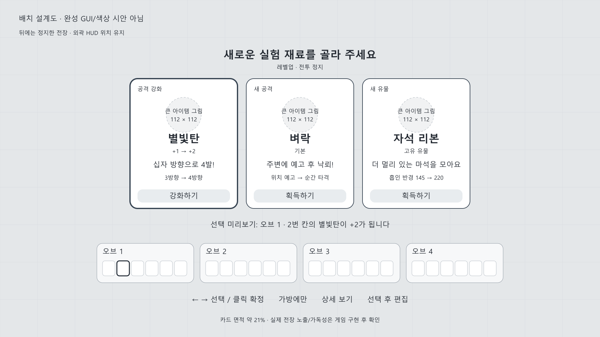

# 획득·선택 UI 조사와 구현 명세

2026-10-28. **공개 화면 비교와 설계만 수행. 게임 UI는 수정하지 않았다.**

연결 문서: [전체 시스템 개편안](CONTENT-AND-CORE-REDESIGN-v1.md), [몬스터 제작 계획](MONSTER-SPRITE-PLAN-v1.md).

## 1. 문제의 핵심

우리 화면의 문제는 보라색이 부족하거나 모서리가 덜 둥글다는 것이 아니다.

- 신규 획득/강화/연결/완성 합성이 비슷한 텍스트 패널에 들어가서, **무엇을 얻고 전투가 어떻게 바뀌는지** 먼저 읽히지 않는다.
- 아이템 이름·역할·강화 변화·조작 설명·제작 비용·조합 해설이 같은 시각적 무게로 놓인다.
- 보상 수령과 긴 조합 편집이 한 화면에 몰려, 선택 순간의 기대감보다 업무 양식의 느낌이 앞선다.
- 실제 마법 아이콘이 작고, 큰 패널의 여백을 설명 문장으로 채운다. 공통 컴포넌트를 재사용하는 것과 모든 상황을 같은 패널로 만드는 것은 다르다.
- 사용자가 제공한 괴수공주 화면은 캐릭터/아이템 그림, 선택 카드, 우측 능력치, 전투 HUD의 위치와 크기를 일관되게 사용한다. 같은 색으로 바꾸는 것만으로 그 차이를 해결하지 못한다.

**이번 권고:** 전장을 뒤에 남기고 중앙에 떠오르는 3개의 ‘마법 실험 카드’. 획득은 짧고 크게, 편집은 원할 때 여는 별도 작업대로 나눈다. 마법/유물/오브는 공통 카드 골격을 쓰되 결과 내용이 달라야 한다. 상자는 그 앞에 짧은 개봉 단계를 둔다.

## 2. 실제 화면 비교

설치된 참고 게임을 실행/조작/캡처하지 않았다. 아래 공개 이미지를 브라우저로 실제 열어 정지 화면을 확인했다. 정지 이미지에서 애니메이션 시간·입력 지연·정지 여부까지 측정했다고 주장하지 않는다. 개발사 갤러리와 사용자 캡처의 출처도 구분한다.

### 비교 표

| 작품·확인 화면 | 확인한 정보 구성 | 우리에게 가져올 것 | 가져오지 않을 것 |
|---|---|---|---|
| **HoloCure** 레벨업: 공식 Steam 갤러리 | 좌측 캐릭터/능력치, 우측4개 가로 선택, NEW와LV2 표시, 선택 테두리/화살표, 하단 조작 | 신규·강화 라벨, 관련 능력만 비교, 선택 대상의 선명한 강조 | 4개 선택지나 긴 여러 줄 설명을 그대로 복사하지 않음 |
| **Deep Rock Galactic: Survivor** 강화: 공식 Steam 이미지 | 중앙3세로 카드, 아이콘/제목/희귀도 띠/큰 변화값/대상 무기, 하단 보유 무기 | 3카드의 짧은 정보 위계, 무엇에 적용되는지 대상 명시 | 공업 금속 스타일·희귀도를 공격/보조 역할 색으로 혼용 |
| **20 Minutes Till Dawn** 강화: 공식 Steam 갤러리 | 선택 아이콘 행, 하나의 큰 상세, 우측 후속 강화 미리보기, 아래 확정 | 최종 변화를 작은 그림으로 예고, 이후 합성 경로 확인 | 선택을 모두 하나씩 눌러야 내용을 아는 작은 아이콘만의 주 UI |
| **Halls of Torment** 특성: 개발사 공지 이미지 | 큰 원형 그림+가로 선택행, 제목/변화 한 줄, 보조 조작 별도 | 한 후보 한 효과, 옵션 도구는 카드 본문에서 분리 | 석판·어두운 공포 표현, 한 화면에 모든 기능 펼치기 |
| **Vampire Survivors** Treasure Found: Nintendo 공식 이미지 | 전장/HUD 위 중앙 상자·OPEN·제목, 전투와 연결된 획득 장면 | ‘발견→개봉→결과’ 구분, 상자가 남긴 기대감 | 개봉 시간을 정지 이미지에서 추측하거나 긴 강제 연출 도입 |
| **Brotato** Wave11 상점: Steam 커뮤니티 가이드 캡처 | 좌측4상품, 우측 능력치, 하단 보유 아이템/무기, 가격/잠금/진행 영역 분리 | 보유 빌드를 보며 선택, 구매와 다음 전투 버튼 분리 | 회색 전체 화면·많은 통계·상점 화면을 레벨업에도 똑같이 사용 |
| **괴수공주**: 사용자 제공18장 | 메뉴/HUD/선택/상점/결과가 공통 곡선·아이콘·제목·캐릭터/아이템 그림으로 연결 | 아이템 그림의 크기, 장면별 주인공, 일관된 위치·형태·선택 반응 | 흰색/보라색만 흉내 내기, 복잡한 설명과 통계를 그대로 이식 |
| **마법공예**: 사용자 제공 가방/유물 화면 | 가방/장착 슬롯이 구역과 배경 판으로 묶임, 유물은 그림 목록+선택 상세 | 슬롯 소속과 보조 적용 관계의 시각적 묶음, 상세는 선택 시 | 다른 게임의 장식 프레임/상표/일러스트를 추출해 사용 |

마법공예 공개 규칙 자료는 전체 개편안 3절에 따로 기록했다. 이 UI 비교표는 원작 모든 보상 종류를 조사했다는 뜻이 아니다. 우리 게임의 레벨업/상자/유물/오브 상황을 설계하기 위해 서로 다른 정보 배치를 비교했다.

### 이 비교에서 내린 판단

1. **큰 그림이 먼저, 변화가 다음, 설명은 마지막**이어야 한다. 현재처럼 작은 기호와 문장만으로 카드 면적을 채우면 스킨을 사도 문서 느낌이 남는다.
2. 신규와 강화는 테두리만 다르게 하지 않는다. `새 공격`과 `+1 → +2`를 가장 먼저 보이게 한다.
3. 보유 빌드를 비교할 자리는 필요하지만 모든 능력치를 항상 펴놓을 필요는 없다. 우리의 핵심은 4오브 조합이므로 하단에 오브 요약, 관련 유물은 선택 시만 보여준다.
4. 레벨업은 빈번해서 빨라야 하고 상자는 드물어서 개봉의 기대감을 줄 수 있다. 같은 기능이라는 이유로 같은 길이의 연출을 반복하지 않는다.
5. 전장은 완전히 가리지 않되 선택할 때만 명확히 정지한다. 투명도를 올려 글자까지 읽기 어려워지는 방식은 피한다.

## 3. 화면 배치 — 1920×1080 기준

아래 숫자는 출력 해상도 기준 설계값이다. 현재 프로젝트의 논리 뷰포트/확대 설정을 바꾸라는 뜻이 아니다. 구현 시 anchors/컨테이너와 단일 스케일 기준으로 환산한다. 화면마다 별도의 임의 배율을 넣지 않는다.

| 요소 | 위치/크기 목표 | 내용 |
|---|---|---|
| 전장 | 전체 | 정지한 직전 전투 장면, 약35~45% 암막. 전체 고비용 블러는 기본 사용 안 함 |
| 획득 제목 | 중앙 상단 y=160~220 | 레벨업/상자 보상/오브 강화, 작은 출처와 큰 결과 제목 |
| 카드3장 | x=416/788/1160, y=252, 각344×416 | 총 폭1088. 본문 스크롤 없음 |
| 선택 미리보기 | y=700~744 | ‘오브1·4번 칸에 장착’, ‘장착한 별빛탄이 +2가 됩니다’ 등 한 문장 |
| 보유 오브 요약 | 중앙 하단 y=780~906 | 오브1~4의 실제 위치/빈칸/단계, 획득 적용 예상 칸만 강조 |
| 보조 조작 | y=950 근처 | ←→ 선택/클릭 확정, 가방에만, 상세, 선택 대기 개수 |
| HUD | 기존 외곽 위치 | HP/마석/시간 유지. 선택 중에는 중요도 낮춰 카드와 경쟁하지 않음 |

3장의 카드 면적은 화면의 약21%다. 제목/요약/조작을 더해도 큰 직사각형 바탕판 하나로 화면 대부분을 채우지 않는다. 숫자는 불투명 면적 기준이며 암막 때문에 실제 전장이 읽히는 정도는 게임 화면에서 별도 확인한다. 하단 오브가 많아도 카드를 축소하지 않고, 선택 오브만 자세히 펼치는 구성을 사용한다.

이 그림은 배치 검토용이며 최종 게임 색/스타일이나 완성 스크린샷이 아니다. 회색 바탕을 그대로 전장에 덮거나 빈 그림 원을 최종 카드로 사용하는 구현이 아니다. [편집 가능한 SVG](ACQUISITION-LAYOUT-v1.svg).

### 카드 내부 위계

1. 상단 작은 표식: **새 공격 / 공격 강화 / 새 보조 / 새 연결 / 유물 / 오브 성장 / 완성 합성**.
2. 큰 그림 영역 약112×112. 실제 구체/유물 그림을 넣는 자리다. 현재 기호 아이콘은 기능 시안으로만 사용하며 최종 일러스트라고 주장하지 않는다.
3. 이름26~28px, 단계 표시는 별3개 또는 `+1 → +2`. 오브 성장만 별도5점으로 표시.
4. **변화 한 문장** 22~24px, 최대2줄. 예: “3방향이 4방향으로 늘어나요.”
5. 작은 전/후 도해64px높이 또는 수치 비교 한 줄. 예: 전방1+후방2 → 십자4.
6. 하단 행동 버튼. 카드 전체 클릭도 같은 동작, 더블클릭 불필요. 호버/포커스/선택은 테두리·높이·빛 효과로 구분.

3장 본문 높이는 같게 유지한다. 설명이 길면 마우스오버/상세 키로 이동시킨다. 카드 안에 법칙·계산 예외·구현 용어를 늘어놓지 않는다.

### 역할은 색만으로 구분하지 않는다

| 종류 | 아이콘/프레임 문법 | 글자 표식 |
|---|---|---|
| 공격 | 둥근 사각 틀 안에 발사/타격 그림 | 공격 |
| 보조 | 육각 받침+작은 변화 표식 | 보조 |
| 연결 | 양 끝이 열린 연결 고리+사건 그림 | 연결 |
| 유물 | 원형 메달/물건 그림 | 유물 |
| 오브 강화 | 오브의 고유 번호·5점 성장 표시 | 오브1 강화 등 |
| 완성 합성 | 해당 역할 프레임+작은 완성 배지 | 완성·추가 강화 없음 |

공격의 번개 그림과 연결의 화살표만으로 구분하지 않는다. 작은 HUD에서는 역할 모양, 작업대에서는 모양+짧은 글자, 상세에는 실제 발동 조건을 제공한다. 역할 색과 희귀도 색을 같은 의미로 쓰지 않는다. 새 희귀도 RNG를 이번 작업 때문에 만들지 않는다.

전체 팔레트/장식 프레임은 아직 확정하지 않는다. 사용자가 거절한 흰색·보라색 화면을 그대로 더 칠하는 작업이 아니다. 먼저 위계/배치/그림 크기를 검증하고, 구매 GUI 또는 확정 아트의 공통 형태·선·재질을 적용한다.

## 4. 상황별 실제 플레이어 텍스트

| 획득 상황 | 카드에 보일 것 | 상세/처리 |
|---|---|---|
| 신규 별빛탄 | `새 공격 / 별빛탄 / 빠른 탄환을 쏴요 / 기본` | 예상 장착 위치, 안 맞으면 가방 보관 |
| 별빛탄 +1→+2 | `공격 강화 / 별빛탄 / +1 → +2 / 십자 방향으로 4발!` | 기존 슬롯 그대로, 3→4방향 그림. 계산식은 상세 |
| 신규 추적 | `새 보조 / 추적 / 공격이 적을 향해 약하게 휘어요` | 장착 예상 묶음 강조. 유도 강도를 과장하지 않음 |
| 명중 후 +0→+1 | `연결 강화 / 명중 후 / 후속 위력 50% → 65%` | 발동1회 유지. 공격 마법을 새로 받는 것이 아님 |
| 자석 리본 | `새 유물 / 자석 리본 / 더 멀리 있는 마석을 끌어와요` | 아래 작은 반경 비교. 오브 슬롯에 끼우지 않음 |
| 오브 소켓 성장 | `오브1 강화 / 여분 소켓 / 6칸 → 7칸` | 해당 오브 끝에 빈칸 등장, 다른 오브는 그대로 |
| 상자 합성 | `완성 합성 / 초신성 정원 / 두 주문이 하나의 정원이 돼요` | 부모 꽃폭탄+3·씨앗+3 → 완성, 소비/자리 변화가 눈에 보임 |

‘독립 주문 인스턴스’, ‘후손 배율’, ‘재복제 불가’ 같은 개발 문장을 메인 보상 카드에 쓰지 않는다. 단, 플레이어의 선택을 바꾸는 불이익은 숨기지 않는다. 예: 왕관 카드에는 **받는 피해+20%**도 보인다. 작은 상세창은 숨겨진 손해를 변명하는 곳이 아니다.

## 5. 레벨업·상자·유물·오브의 연출

다음 시간은 **우리 구현의 초깃값**이며 원작에서 측정한 값이 아니다.

### 레벨업: 빠른 일상 선택

`전투 정지 → 0.18초 제목/카드 등장 → 3개 비교 → 선택 → 0.2초 획득 피드백 → 전투 복귀`.

- 최초 키/클릭을 떼기 전에는 보상 확정 금지. 전투 클릭이 곧바로 첫 카드를 선택하지 않게 한다.
- 한 번의 클릭/확정으로 획득. 확인 모달을 또 띄우지 않는다.
- `자동 장착`이 가능하면 예상 칸으로 아이콘이 짧게 이동, 강화는 기존 아이콘의 별이 한 개 켜진다. 유물은 유물 줄로 간다.
- 미수령이 여러 개면 전투를 재개했다 다시 멈추지 말고 다음 선택을 이어서 보여준다. 모든 선택을 끝내고 복귀한다.
- 선택 후 인벤 강제 열기를 매번 반복하지 않는 안을 권고한다. **‘선택 후 편집’은 누르면 같은 정지 상태로 작업대에 들어가고, ‘계속’에서 재개한다.** 현재의 선택후 편집 흐름과 달라지는 옵션이므로 설정/기본값을 명시해 적용한다.

### 보물상자: 발견의 기대감

`필드 상자 접근 → 정지 → 중앙 상자/OPEN → 개봉 0.7~1.1초 → 3보상 → 획득`.

- 상자에서 나오는 것이 보유 강화뿐이어도 최종 선택은 기존 규칙대로3후보 중1개다. 원작이 여러 아이템을 주는 장면을 봤다고 우리도 몰래5개 지급하지 않는다.
- 합성 가능 시 최소1후보는 완성 합성. 다른 보유 강화와 나란히 선택 가능.
- 첫 완성 합성만 최대1.6초의 부모 합쳐지는 도해를 사용. 이후는 일반 길이, 처음부터 건너뛰기 가능. 빠른 획득 설정은0.15초 내외로 줄인다.
- 첫 개봉 화면은 눌러야 열리는 장면이지만, 반복 상자는 ‘빠른 개봉’ 설정으로 생략 가능. 기다림을 보상 가치의 대용품으로 쓰지 않는다.
- 보유 마법이 전부 만강/합성 불가면 돈/회복의 실제 fallback만 표시. 빈 카드를 그럴듯하게 채우거나 신규 마법을 규칙 밖으로 넣지 않는다.

### 유물

레벨업에서 유물을 선택하면 카드의 물건 그림이 획득 메달로 강조되고 HUD 유물 줄로 이동한다. 피해 증가 등 수동 조작 없는 효과는 인벤 장착 화면을 열지 않는다. 유물 제작은 같은 획득 피드백을 쓰되 카드의 가격·확정 주체가 다르다.

### 오브 획득/강화

- 새 오브: 큰 오브가 플레이어 옆에 추가되는 짧은 시각 피드백+빈6칸. 어떤 주문도 공짜 복제하지 않는다.
- 강화: **먼저 대상 오브가 화면에 크게 표시**되고 후보3장이 뜬다. 카드를 고르는 중 다른 오브로 전환해 결과 대상을 바꾸지 않는다.
- 후보의 피해/속도는 해당 오브의 현재 값→예상 값을 표시한다. 별5개가 마법의3강과 혼동되지 않게 오브 번호와 함께 놓인다.
- 비용은 후보창에 들어가기 전 ‘오브1 강화/50마석’로 확인하고, 선택 확정 시1회 지불. 취소하면 미소비. 유효 후보가 없으면 구매를 시작하지 않음.

## 6. 전투·편집·일시정지의 관계

보상/상자/오브 선택은 정지, 일반 인벤은 비정지라는 사용자 규칙을 유지한다. UI가 떠 있다는 이유로 일괄 정지하지 않는다.

| 모드 | 세계/시계 | 허용 UI | 종료 후 |
|---|---|---|---|
| 전투 | 진행 | HUD/일반 개인 가방 | 계속 전투 |
| 일반 개인 가방 | 진행 | 슬롯 편집/상세 | 가방 닫기만 |
| 획득 선택 | 정지 | 3카드/상세/보유 요약 | 남은 선택 또는 전투 |
| 보상 직후 편집 | 정지 | 작업대, ‘계속’ | 전투 |
| 6분 제작 휴식 | 전투 정지 | 제작/오브성장/유물/가방 | 준비 완료 |
| 시험 발사 | 별도 시험 시뮬레이션 | 시험 버튼/작업대 | 돌아온 휴식/편집, 실제시간 불변 |
| Esc | 정지 | 재개/설정/타이틀 | 열기 전 모드 복원 |

입력은 모드에 따라 라우팅한다. 카드 위 클릭이 뒤의 장착 슬롯/공격에 전달되면 안 된다. 실제 전투 업데이트 함수는 카드 animation/Tween 갱신과 분리한다. 멀티의 전체 보상 정지는 이후 구현하되 개인 인벤 때문에 모두 정지하는 구조를 만들지 않는다.

## 7. 구현 데이터 계약

`RewardChoiceViewModel`에 다음을 모은다.

- 출처(level/chest/craft/orb_upgrade), 고유 receipt/revision, reward_type(new/upgrade/fusion/relic/orb), item ID.
- 역할, 현재/다음 단계, 카드 문장, 전후 비교 데이터, 상세 문장, 관련 대상 UID.
- 소모 재료·돈, 예상 오브/칸, 유효성, 장착하지 않는 이유, 합성 부모의 위치.
- 레벨업·상자·제작·도감은 동일한 설명 생성기를 참조. 화면마다 문자열을 따로 작성하지 않는다.

선택 트랜잭션은 보상 receipt/revision을 확인한 뒤 **획득/강화·부모소모·돈·장착·저장 상태**를 한 번에 갱신한다. Tween 완료 신호에서 실제 돈/아이템을 지급하지 않는다. 연출을 건너뛰거나 프레임이 밀려도 지급 결과는 같다.

UI는 Control/Container+공통 Theme로 만든다. 기존 Godot4.6.2를 유지하며 스킬 문서가4.7을 언급한다고 엔진을 업그레이드하지 않는다. 구현할 API가 불확실하면4.6문서를 확인한다. 배열/오브 수에 따라 HBox/Grid가 배치하고, 고정 픽셀 코드를 각 화면에 복제하지 않는다. 그림 크기·글자 크기·카드 간격은 역할별 공통 상수로 관리한다.

작업 파일 중심: `scripts/interface.gd`, `scripts/level_reward_ui.gd`(기존 builder 확인), `scripts/prep_board.gd`, `scripts/prep_slot.gd`, `scripts/combat_rewards.gd`, `scripts/game.gd`. 파일을 새로 쪼개는 것이 목적이 아니라 보상 계산/표시/입력을 분리하는 것이 목적이다.

## 8. 아트/GUI 구매에 필요한 목록

이번에는 구매 후보를 다시 무작정 늘리지 않았다. 사용자가 기존 후보를 마음에 들어 하지 않았으므로 **확정 레이아웃에 필요한 부품**을 먼저 명시한다.

- 카드 프레임 1가족: normal/hover/focus/selected/disabled, 모서리와 선 두께 일관.
- 공격/보조/연결 역할 프레임3종, 신규/강화/완성 표식, 별3개·오브성장5점.
- 일반 상자 closed/open2상태, 희귀/완성은 오버레이로 표시. 이펙트가 있어도 상자 원화가 필요.
- 마법/합성/유물 아이콘54+24개. 현재 아이콘에 라벨만 바꾼 것을 새 아트78개라고 세지 않는다. UI 아이콘이 VFX 팩에 전부 포함된다고 가정하지 않는다.
- 큰 획득 원형 장식/짧은 반짝임, 선택 확인/획득/상자 개봉 효과음. BGM은 사용자 준비까지 추가하지 않음.
- 한글 폰트는 현재 Jua의 가독성/긴 이름/작은 설명에서 실제 검토. 폰트1개만 바꾸는 것으로 최종 UI 작업을 끝내지 않는다.

무료/구매/직접 제작 경로는 출처와 상업 이용 조건을 매니페스트에 기록한다. 유료 팩은 대표 카드와 슬롯을 실제 축소 크기에서 보여준 뒤 선택한다. 이번 배치도는 구매 결정을 대신하거나 최종 아트 승인을 받은 결과가 아니다.

## 9. 검증·완료 기준

### 기능

- 신규/강화/합성/유물/오브 후보가 실제 결과와 같은 이름·단계·위치·비용을 표시.
- +3 제외/부모+3/완성1회/부모 재등장, 슬롯 빈칸 보존, 자동 장착의 안전한 후보 계산.
- 반복 클릭/키 유지/빠른 개봉/취소/입력 장치 전환에도 한 번만 지급.
- 선택 정지/일반가방 비정지/시험 시간 불변/Esc복원.
- 3개 미만 후보에서 fallback 정확. 유물 중복/오브 최대단계는 회색 가짜 선택지로 채우지 않음.

### 실제 화면

- 1920×1080 및1280×720에서3카드 겹침·본문 스크롤·이름 잘림 없음. 한글 긴 합성명과 오브8칸/4개 검수.
- 공격/보조/연결을 색을 보지 않고도 구별. NEW와단계변화를1초 안에 읽는지 사용자에게 확인.
- 전장과 피격 위협의 위치가 배경에 남아 있고, 선택 때 전투가 멈췄다는 표식이 보임.
- 카드→슬롯/유물 줄 피드백이 실제 위치로 향함. 전투가 재개되기 전에 준비되지 않은 상태를 몰래 덮어쓰지 않음.
- 혼잡 전장 위에서도 포커스와 텍스트가 읽힘. 블러/과한 반짝임으로 프레임 시간을 악화시키지 않음.

### 재미/사용성 — 자동 검사와 별개

같은 플레이어가 새 화면에서 보상10회 선택할 때 선택 시간, 상세창 연 횟수, 실수 장착, 편집 진입률, 어떤 역할을 골랐는지 설명 가능한지를 본다. ‘예쁘다’/‘게임 같다’는 사용자 평가와 취향이므로 기능 검사 통과로 대신하지 않는다. 연출을 기다려야 지루한지, 강화 변화가 기대되는지를 따로 확인한다.

## 10. 공개 참고 화면 링크/증거 한계

- [HoloCure 공식 레벨업 이미지](https://shared.akamai.steamstatic.com/store_item_assets/steam/apps/2420510/ss_7a15a419e71af6c3e27cf077056ec497fe411649.1920x1080.jpg?t=1740642230)
- [DRG Survivor 공식 강화 이미지](https://cdn.cloudflare.steamstatic.com/steam/apps/2321470/ss_d1b7d0c383471561aaa4bdcdfc6f2c4e306ac859.1920x1080.jpg?t=1707392336)
- [20 Minutes Till Dawn 공식 선택 이미지](https://shared.akamai.steamstatic.com/store_item_assets/steam/apps/1966900/ss_9c6155d820182d5f2e3298f38011e61cbd5f5966.1920x1080.jpg?t=1785102761)
- [Halls of Torment 개발사 공지 이미지](https://clan.akamai.steamstatic.com/images/43496740/cd2961505959d5105b1dca54515163996d1fe436.png)
- [Vampire Survivors Nintendo 공식 상자 이미지](https://www.nintendo.com/eu/media/images/06_screenshots/games_5/nintendo_switch_download_software_2/nswitchds_vampiresurvivors/NSwitchDS_VampireSurvivors_05.jpg)
- [Brotato 공개 상점 캡처](https://images.steamusercontent.com/ugc/2015953485216121198/B6B78EA0A7D80B89CEF90D0C40150DFF98846479/), [원문 가이드](https://steamcommunity.com/sharedfiles/filedetails/?id=2896126855)
- 괴수공주18장과 마법공예 화면은 이번 대화의 사용자 첨부. 설치 데모 분석/원화 추출 아님.

상점 소개 문구만 읽고 UI를 본 것으로 세지 않았다. Hades 공식 업데이트도 읽었지만 이번에 구체적인 선택 화면을 직접 확인한 비교 대상 수에는 포함하지 않았다. 정지 이미지에서 알 수 없는 전환 시간/기본 정지 정책/패드 조작은 참고작의 사실로 보고하지 않는다.
