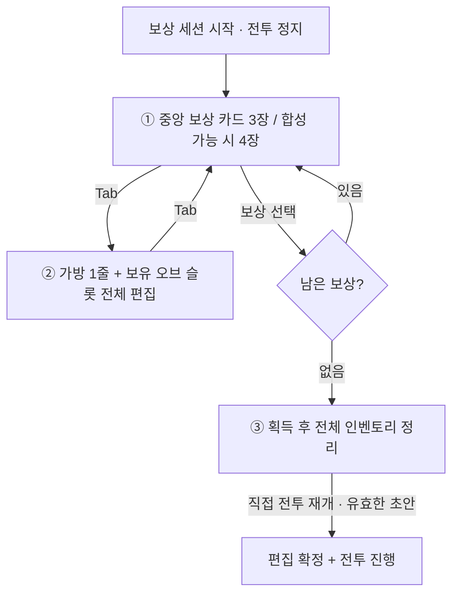

# UI-REWARD-2026-10-31-01 · 보상 선택·Tab 인벤토리·획득 후 정리 UI 최신 승인안 v1

> **상태: LATEST / APPROVED — 사용자 2026-10-31 채용 목업 기준의 보상 UI 화면 구조.**
>
> **이 문서가 레벨업 보상 선택/인벤토리 연계의 최신 사용자 승인 설계다.** 이전 [UI-2026-10-30-01](2026-10-30-combat-hud-reward-chest-ui-proposal.md), [UI 통합 설계 v0.2](2026-10-31-ui-integrated-design-v02.md), [2026-10-28 획득 UI 연구](../../ACQUISITION-UI-RESEARCH-v1.md)의 상충하는 배치·상호작용 제안은 구 참고안이다.
>
> **구현 상태: 설계 승인 / 게임 코드 수정 없음 / Godot 실행·입력·시각 검증 없음.** 이전 답변의 임의 5열 격자 가방·오른쪽 분리 장비창 목업은 **REJECTED / 사용 금지**.
>
> **범위 주의:** 보상 UI **3상태 배치·편집 흐름만 승인**. 보물상자 개봉/잭팟 VFX, 상자 확률, 최종 GUI 아트, 카드 애니메이션·세부 색상, 카드 크기의 픽셀 단위 확정까지 승인한 것은 아니다.

- 작성: 2026-10-31 (KST)
- 정식 작업 저장소: https://github.com/LittleEvasn/witchlings-mayhem
- 사용자 직접 승인: “좋아 이게 맞지 이대로 보고서 올려놔”
- 참고: [전투 HUD 최신 승인안](2026-10-31-combat-hud-revised-approved-v1.md) / [확정 결정](../decisions/2026-10-31-approved-reward-ui-inventory-three-state-flow.md)
- 참고 게임: **Deep Rock Galactic: Survivor**(중앙 3세로 카드), **Magicraft**(마법 슬롯과 가방의 관계), **Vampire Survivors**(빠른 정지 보상 선택). 참고는 UI 정보 위계에 한하며 **실제 인벤토리의 구조는 자사 Godot 코드가 기준**.

## 1. 사용자 채용 목업 파일 (정확한 식별)

| 순서 | 원본 파일명 | 해상도 | SHA-256 | 의미 |
|---|---|---|---|---|
| 비교 | `00_three_states_overview.png` | 2200×1390 | `6ddd8631cfcb01c0e16147774046a557c00ead90fcaec7a52039f1958d46b1fa` | 세 화면 비교·최종 채용 판단 |
| ① | `01_reward_selection.png` | 1600×900 | `482719421239b6facfa6080e6f604c207ea511132de600a90ed139c36c23994c` | 보상 선택, 카드가 슬롯 일부를 겹침 |
| ② | `02_tab_inventory_edit.png` | 1600×900 | `5476819537b6d6656c5b9d7ac3d6fd4a240e0d74d397b745dd669d8656d9f800` | Tab으로 카드 숨김, 인벤 전체 확인·편집 |
| ③ | `03_after_reward_reorganize.png` | 1600×900 | `aef5e5ceed23fc186eaf736d5f179420c0f62c05d2510bd5deff2894bac70847` | 획득 후 정리, 직접 전투 재개 |

**이미지 원본 보존 관련 한계:** 위 PNG는 채팅에서 실제로 제공한 **배치 확인용 목업**이며 Godot에서 실행해 캡처한 이미지가 아니다. **이 Markdown 커밋 자체에 PNG 바이너리 업로드가 포함되어 있지 않다**. 따라서 GitHub 저장소에 원본 PNG가 있는 것처럼 상대 이미지 링크를 만들지 않는다. 사용자 채용안은 이 파일명/SHA와 다음 명시적 배치 계약으로 식별한다. 원본 PNG가 별도로 업로드되면 링크를 추가한다.

**모든 목업의 아이콘·마법 내용물·유물·수치·오브 수량은 배치를 이해하기 위한 예시.** 그 사례가 특정 런에 실제 보유되는 아이템·정확한 능력치나 신규 시스템의 승인을 의미하지 않는다.

## 2. 공통 인벤토리 구조 — 실제 Godot 구현을 기준으로 고정

다음 구조는 창작 UI가 아닌 [`scripts/compact_inventory.gd`](../../scripts/compact_inventory.gd)의 계약이다.

1. **가방 1줄:** 좌측 `가방` 표식 + 한 줄로 길게 이어진 실물 슬롯. **최소 31칸**(`maxi(31, bank.size()+1)`), 44×44 셀/간격 4. 오른쪽으로 넘치면 `inventory_bag_scroll.gd`로 **가로 스크롤**. **여러 페이지·여러 열 격자·왼쪽별/오른쪽별 장비창으로 분할하지 않는다.**
2. **오브:** 가방 **아래**에 실제 보유 오브 수만큼 가로 한 줄씩. 최대 4개, **각 오브의 실물 칸 수 6~8칸**. 오브 제목·번호와 보유 마법이 같은 줄에 있어야 한다.
3. **조작:** 실제 `prep_slot.gd`를 사용해 가방 ↔ 오브 드래그, 슬롯 간 교환/배치, 오른쪽 클릭 해제, 더블클릭 빠른 장착, `되돌리기` 기능을 보존.
4. 시작부터 오브 4개를 지급하는 게 아니다. **현재 보유 오브 수만큼만 표시**하고, 없는 오브 3/4는 생성하지 않는다.
5. 인벤토리의 실제 단일 데이터 출처는 `economy.inventory`(가방) + `orb_drafts`(오브 편집 초안) 및 관련 재고/예약 계산. 일러스트를 실데이터처럼 고정하지 않는다.
6. 가방·오브는 **별개의 양식 창 두 개가 아니라 같은 `CompactInventory` 편집 패널**이다. 보상 모드와 일반 Tab은 이 실물 슬롯 컨트롤을 재사용한다.

### 2.1 화면 구조도 (코드 의미 그대로)

```text
┌──────────────────────────── [가방: 수평 한 줄 / 31칸 이상 / 좌우 스크롤] ────────────────────────────┐
│ [가방] [마법][마법][마법][빈칸] ... [빈칸][빈칸]                                       [→ 스크롤] │
└──────────────────────────────────────────────────────────────────────────────────────────────────┘
 [오브 1] [슬롯1][슬롯2][슬롯3][슬롯4][슬롯5][슬롯6]     (실제 6~8칸)
 [오브 2] [슬롯1][슬롯2][슬롯3][슬롯4][슬롯5][슬롯6][슬롯7]
 [오브 3] [슬롯1][슬롯2][슬롯3][슬롯4][슬롯5][슬롯6]
 [오브 4] [슬롯1][슬롯2][슬롯3][슬롯4][슬롯5][슬롯6][슬롯7][슬롯8]
 [되돌리기]    (상단 예시는 네 오브를 보유한 중간 런을 표현한 것)
```

## 3. 승인된 세 가지 UI 상태

### ① 보상 선택 화면 — **중앙의 큰 3택 / 조건부 4택**

- 보상 모달은 전투를 **일시정지**한다. 이전 전투 장면은 뒤 배경으로 남고 선택지에 집중하도록 어둡게 표시한다.
- **보상 카드는 화면 중앙**, 3장(조건부 합성 4장). 중앙에 두기 위해 **상단 인벤토리의 오브 슬롯 일부를 카드가 가려도 된다.**
- 가방/오브는 배경에 일부 보여서 플레이어가 자신의 마법 구성을 파악할 수 있다. 보상 카드가 아래로 밀려서는 안 된다.
- 카드에는 실제 마법 아이콘, 이름, 신규/강화 구분, 현재 효과·변화, 필요시 합성 재료를 제시한다.
- **보상 후보가 화면을 닫았다 열었다 한다고 재추첨되어서는 안 된다.** 선택 시 후보 ID/revision 안전성 유지.
- 이 상태에서 인벤토리로 들어갈 **Tab 동작**을 제공해야 한다.

### ② Tab 인벤토리 확인·편집 — **보상 카드만 숨김**

- Tab을 누르면 보상 카드를 **잠시 숨기고**, 동일한 `CompactInventory`의 **가방 한 줄 + 보유 오브별 전체 슬롯**을 표시한다.
- 가방을 가로 스크롤하며 실제 마법을 확인, **드래그 앤 드롭·우클릭·되돌리기로 편집**할 수 있다.
- **전투는 계속 일시정지**되어 있어야 한다.
- 다시 Tab → 같은 보상 선택 화면으로 돌아감. 보기 전환만으로 획득/보상 개수·후보 목록이 변경되거나 보상이 소비되면 안 된다.
- 편집으로 합성 후보의 실제 유효성이 변경될 수 있으므로 **표시 후보는 잠금 상태로 보존하되** 선택 직전 유효성은 기존 게임 검증을 따르며, 부적합한 경우 무단 재추첨/중복 지급 없이 처리한다. 정확한 무효 후보 UX는 구현 시 별도 검토.

### ③ 보상 획득 후 정리 — **편집이 주인공**

- 보상 카드는 **사라지고**, 가방·오브의 편집 슬롯 **전체가 드러난다.**
- 획득 결과를 간결히 표시하되 기존 인벤 UI를 대체하는 가짜 결과창/가짜 장비창은 추가하지 않는다.
- **새로 소유한 일반 마법:** 가방에 추가, 자동 장착 금지.
- **이미 장착된 마법의 강화:** 기존 장착 위치를 따라 업그레이드될 수 있음(`game.apply_acquisition` 확인).
- **합성:** 필요한 부모 마법을 소비하고 실제 오브 슬롯/가방이 변경될 수 있음(`game.claim_fusion` 확인).
- 남은 보상이 있다면 기존 `pending` 순서대로 다음 선택을 완료한 뒤 최종 편집 단계로 들어간다.
- **‘전투 재개’ 버튼을 직접 누를 때까지 전투 정지 지속.** 편집 가능한 시간에 제한을 두지 않는다.
- 드래프트가 유효해야 재개 가능하며, 재개 시 편집 내용을 확정한다.

## 4. 현행 코드와 차이 — 구현 여부를 거짓으로 표시하지 않는다

| 요소 | **2026-10-31 현재 코드** | **사용자 승인 목표** |
|---|---|---|
| `compact_inventory.gd` | 가방 1줄 가로 스크롤 / 보유 오브 가로 행 / 되돌리기 구현 | **기존 컨트롤 재사용** (재제작 금지) |
| `level_reward_ui.gd` | `Inventory.build(ui,root,true)`를 항상 생성. 카드 `top=350`, 높이 398 | 보상 카드가 **중앙 시각 중심**에 오게 하고 인벤 일부 겹침 허용 |
| `game.gd::_unhandled_input` | 보상 정지 중 `Tab`은 `return`으로 무시 | Tab을 **보상 카드 표시 / 전체 인벤 편집** 보기 전환에 사용 |
| `combat_rewards.gd` | `choice → edit`, 보상 세션 중 정지, `continue_combat` 직접 호출 | 위 상태 흐름 유지. 인벤 보기 전환과 보상/세션 `stage`는 분리 |
| `combat_rewards.gd::refresh_options` | 보상 후보와 합성 후보를 관리, `fusion_locked`와 `revision` 사용 | **Tab 보기에 따른 재추첨 금지**, 후보/재고 정합성 유지 |
| `apply_acquisition` / `claim_fusion` | 강화는 기존 장착 마법 대체 가능, 합성은 부모 소비·배치 변경 가능 | 획득 결과를 실제 행동대로 표시. “항상 가방에만 지급”이라는 거짓 규칙 추가 금지 |

**실제 게임 코드는 이 문서 등록에서 수정하지 않는다.** 이 표는 차이점과 향후 인계 지점만 정리한다.

## 5. 화면 상태와 보상 상태 분리



**입력 계약:** 중앙 보상 카드 표시 여부는 `selection_view`/`inventory_view` 같은 **UI 보기 상태**로 관리할 것을 권장하며, 기존 보상 지급 `stage`/후보/중복 수령 방지 로직을 바꾸는 핑계가 되어서는 안 된다.

## 6. 테스트·완료 기준 (승인된 디자인을 구현하는 경우)

1. 1600×900, 1280×720, 1920×1080에서 카드가 중앙에 있고 스크롤/슬롯이 잘리지 않음.
2. 3택과 조건부 4택 모두 카드 크기·선택 영역·가방/오브 일부 겹침이 일관됨.
3. 가방은 1줄·최소 31칸·가로 스크롤이며 2D 격자/페이지로 바뀌지 않음.
4. 보유 오브 개수 1/2/3/4 각각 실제 줄 수와 6~8개 실슬롯 반영.
5. 보상 선택 중 Tab → 전체 인벤/편집 → Tab → 동일한 후보 카드 복귀.
6. Tab 열고 닫기만으로 후보 재추첨, 보상 지급, 무료 합성, 드래프트 리셋/중복 지급이 일어나지 않음.
7. 보상 선택 후 신규 마법/기존 장착 강화/합성의 **실제 획득 반영 위치**가 코드와 일치.
8. 모든 보상 소진 후 편집 화면에서 **전투 재개 버튼**을 누르기 전까지 게임 세계 시계/적/마법 정지.
9. 드래그 중/클릭 연타/Tab 빠른 연속 입력/가방 스크롤·우클릭·되돌리기와 입력 안전장치 충돌 없음.
10. 실제 Godot 화면 캡처와 사용자 승인 목업을 대조하고, 테스트 통과·시각 승인·게임 빌드를 서로 다른 증거로 보고.

## 7. 구 보고서와의 우선순위

- **최신 보상 UI:** 본 문서 `UI-REWARD-2026-10-31-01`.
- **최신 전투 HUD:** [`UI-HUD-2026-10-31-01`](2026-10-31-combat-hud-revised-approved-v1.md). 보상 UI가 일반 전투 HUD 위치를 임의로 변경한다는 뜻이 아님.
- **구 UI-01:** 보상·HUD·상자를 함께 제안한 2026-10-30 보고서. 보상 배치는 본 승인안으로 대체, **상자 개봉/잭팟 연출은 여전히 미승인 제안**.
- **구 통합 설계 v0.2/획득 연구:** 참고 자료로 보존, 상충할 때 최신 승인안 우선.
- **문구:** [유치한 시스템 카피 금지 확정 규칙](../decisions/2026-10-31-battle-ui-copy-tone-no-cutesy-dialogue.md) 우선.
- 외부 레퍼런스 UI 이미지/코드 또는 원작 게임의 드롭 확률·마나 시스템은 이 보고서만으로 이식하지 않는다.
