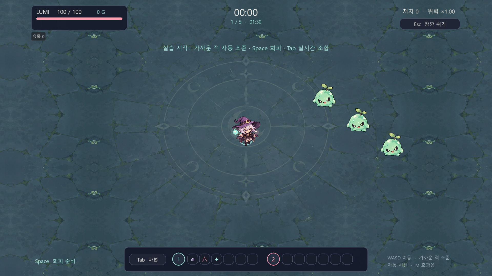
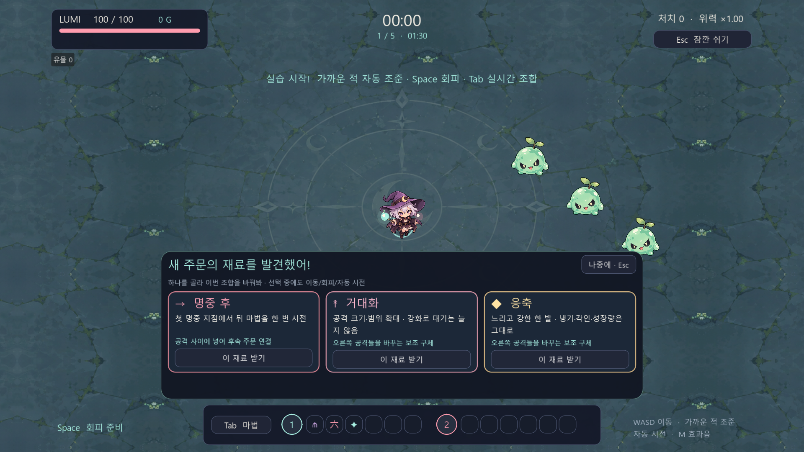
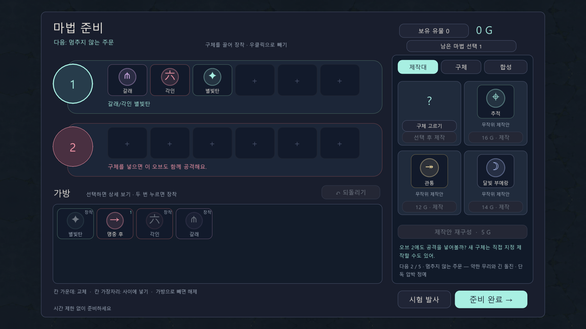
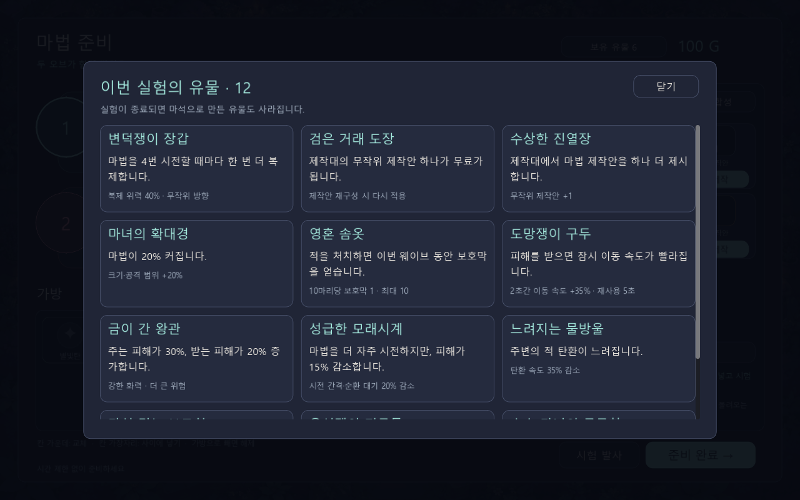

> **구 UI 보고서 (LEGACY REFERENCE · 2026-10-31)** — 이 문서는 이전 UI 제안 기록이다. 전투 HUD 최신 승인 배치는 [UI-HUD-2026-10-31-01](2026-10-31-combat-hud-revised-approved-v1.md)이 우선한다. **과거 HP·유물·EXP·시계·보스 HP바 위치 권고는 최신 기준으로 사용 금지.** 보상·상자·기타 화면은 기존 연구 기록으로 남지만 별도 승인 전까지 미확정이며, 과거 검증 이력은 보존한다.

# UI-VIS-2026-10-31-01 · UI 시각 레퍼런스 보드 v0.1

> **상태: PROPOSED / 원작 이미지는 외부 출처 표시 / 프로젝트 PNG 4종만 GitHub 저장소 내부 첨부.**
>
> [UI 통합 설계서 v0.2](2026-10-31-ui-integrated-design-v02.md)의 §15 **Codex 전달용 이미지 규격**을 부분 보완한다. 텍스트 와이어프레임보다 **실제 원작 UI와 우리 프로젝트의 기존 화면**을 나란히 볼 수 있도록 구성한 **1차 이미지 보드**다.

- **작성일:** 2026-10-31 (KST)
- **증거 수준:** 원작 공개 이미지·원본 페이지/퍼블리셔 이미지 URL 조사 + GitHub에 **기존부터 존재하던** 우리 게임 PNG 4개를 별도 docs 자산 경로로 연결함. **이번에 새 Godot 화면을 캡처하거나 이미지 위에 위치 주석을 직접 그리지는 않았다.**
- **이미지 저작권:** 원작 스크린샷의 저작권은 원 권리자에게 있다. **공개 저장소에 무단 복제해 PNG로 다시 업로드하지 않았다.** 외부 원본 URL을 GitHub Markdown에 임베드해 표시하거나 원문 페이지로 안내한다. 외부 원본 링크가 바뀌면 미표시될 수 있다.
- **프로젝트 PNG:** `docs/ai-workspace/assets/ui-reference/`의 4개 이미지는 **같은 저장소 `artifacts/`에서 이전에 만들어진 스크린샷을 복제한 Git blob**이다. 새 디자인, 새로운 연출 시안, 최신 실행 증거가 아니다.

## 1. 전투 HUD · 시계 및 유물 아이콘

**원작 A — Vampire Survivors**: 전투를 많이 가리지 않으면서 **상단 중앙 시간**을 최우선으로 드러내는 방식을 참고.

- **원본/출처:** [Indie Game Culture — Vampire Survivors](https://indiegameculture.com/guides/vampire-survivors-upgrades-guide/)
- **관찰할 부분 ①:** 상단 중앙의 `13:45` 생존 시간. **참고할 것은 정보 우선순위**, 픽셀 색/원작 그림이 아님.
- **주의:** 기고문에서 제공한 게임 스크린샷이며 화면 버전/원본 촬영 조건을 이번에 재현하지 않았다.

**원작 B — Slay the Spire**: 전투 화면 상단에 다수의 작은 **유물 아이콘**을 나열하는 방식. 이번 스크린샷은 호버 툴팁이 아닌 **아이콘 행 위치** 참고.

- **원본/출처:** [KnowTechie — Slay the Spire 리뷰](https://knowtechie.com/review-slay-the-spire/)
- **관찰할 부분 ②:** 상단 유물 아이콘의 **작은 단위·일렬 연속·수량 증가 시 밀도**. 우리 게임은 **왼쪽 아래** 배치를 우선 검토하므로 **원작 위치까지 복사하지 않는다**.

**우리 게임 기존 PNG — 전투 HUD (2026-10-27 과거 캡처)**

- [우리 게임 PNG 원본 보기](../assets/ui-reference/witchlings-hud-20261027.png)
- **실제 비교 과제:** 시간·가방 펼침·보스 HP·좌하단 유물·우하단 HP가 **같은 해상도에서 겹치는지** 시안 필요.
- **미작성:** 상단 시간 변경 이후 목표 배치 PNG, 상태별 선택·가방 열림 주석 이미지.

---

## 2. 레벨업 3~4택 · 보상 카드

**원작 A — Magicraft 공식 Steam 이미지**: 마법 선택 카드의 **큰 아이콘·이름·종류·수치·주요 효과**를 분리한 세로형 카드.

- **출처:** [Magicraft — 공식 Steam 스토어](https://store.steampowered.com/app/2103140/Magicraft/) / [SteamDB 이미지 목록](https://steamdb.info/app/2103140/screenshots/)
- **관찰할 부분 ①:** 카드 경계, 아이콘과 제목, 짧게 배열된 주요 수치, 선택 후보 간 구분.
- **차이:** 원작 희귀도/마나/주문 카드 규칙은 **우리 게임에 그대로 가져오지 않는다**.

**원작 B — Vampire Survivors 레벨업 화면**: 전투 공간을 배경으로 유지하면서 **중앙에 선택지**가 놓이는 구조. 반드시 세로 카드 3장이 있는 모습은 아니므로 **선택지 비교**만 참고.

- **출처:** [Level Winner — Vampire Survivors 초보자 가이드](https://www.levelwinner.com/vampire-survivors-beginners-guide-tips-tricks-strategies-to-become-the-ultimate-vampire-hunter/)
- **관찰할 부분 ②:** 선택지와 비전투 배경 사이의 **시각적 분리**, 짧은 효과 설명.

**우리 게임 기존 PNG — 보상 선택 (2026-10-27 과거 캡처)**

- [우리 게임 PNG 원본 보기](../assets/ui-reference/witchlings-reward-20261027.png)
- **비교 기준:** 기존 **280×398 / 3장·4장** 분기, 가방 편집과의 화면 점유 충돌, 선택 후 실제 지급/정지 유지.
- **미작성:** 주석 표시가 있는 3장/4장 목표 배치 PNG.

---

## 3. 상점 · 마법 제작 작업대

**원작 A — Backpack Battles**: 구매 가능한 상품이 선반과 가격표로 구분되는 **상점 영역** 참고. 화면 전체의 가방 위치나 인접 규칙까지 이식하는 것은 금지.

- **출처:** [4Gamer — Backpack Battles 기사 및 캡처](https://www.4gamer.net/games/749/G074963/20231026073/) / [이미지 갤러리](https://www.4gamer.net/games/749/G074963/20231026073/screenshot.html)
- **관찰할 부분 ①:** 가격·상점 칸·상품의 구별과 구매/판매 동선. **스크린샷은 구버전일 수 있음.**

**원작 B — Magicraft**: **4개 주문 줄과 보유 오브/마법**의 관계를 보여주는 인벤토리 표현.

- **출처:** [Bahamut — Magicraft 게임 플레이 리뷰 및 캡처](https://forum.gamer.com.tw/Co.php?bsn=60599&sn=138622)
- **관찰할 부분 ②:** 여러 주문 줄, 마법 아이콘의 간격, 보유품의 위치. **원작과 우리 게임의 오브/보조/연결 규칙은 서로 다름.**

**우리 게임 기존 PNG — 제작대 (2026-10-27 과거 캡처)**

- [우리 게임 PNG 원본 보기](../assets/ui-reference/witchlings-crafting-20261027.png)
- **비교 기준:** 상품 목록·선택 마법 상세·실제 가방·오브 슬롯 1~4·시험 발사·준비 완료.
- **미작성:** 외부 레퍼런스에서 가져올 영역 표시 PNG 및 우리 목표 제작대 배치 시안.

---

## 4. 유물 보유 및 상세

**원작 A — Slay the Spire의 전투 보유 아이콘 줄**: 전투 HUD에서 실제 유물 종류와 개수가 **작은 아이콘**으로 남는 점.

- **출처:** [KnowTechie — Slay the Spire 리뷰](https://knowtechie.com/review-slay-the-spire/)
- **참고:** 전투 중 항상 보이는 **보유 아이콘**이며, **선택 유물 상세 카드 예시와 구분**한다.

**원작 B — Slay the Spire 유물 효과 카드 (외부 자료)**

- **출처:** [Gamers Decide — Slay the Spire 유물 소개](https://www.gamersdecide.com/articles/slay-the-spire-best-relics)
- **참고:** 아이콘 → 이름 → 핵심 효과 → 보충 문구. **이미지가 실제 원작 UI인지, 가이드용 편집본인지에 따라 세부 레이아웃 재검증 필요**.
- **주의:** 이 문서를 근거로 우리 게임에 유물 희귀도·강화 시스템을 추가하지 않는다.

**우리 게임 기존 PNG — 유물 목록 (과거 구현 캡처, 최신 UI 아님)**

- [우리 게임 PNG 원본 보기](../assets/ui-reference/witchlings-relic-inventory-archive.png)
- **비교 기준:** 기존 3열 큰 카드 → 아이콘 그리드 + 선택 상세를 검토. 동적 유물 설명은 실제 런 데이터 기준.
- **미작성:** 우리 유물창 새 아이콘 목록 시안·유물 0/1/4/12개 비교.

---

## 5. 아직 부족한 자료와 다음 단계

**이번 보드로 실제로 갖춘 것:**
1. **원작/제3자 공개 이미지의 화면별 출처와 이미지 표시 링크.** 그림 원본을 **GitHub 저장소 내부에 다시 올린 것은 아님.**
2. **우리 게임 PNG 4종을 실제 GitHub 레포의 `docs/ai-workspace/assets/ui-reference/`에 저장**하고 이 문서 안에서 표시.
3. 해당 화면에서 **무엇을 참고하고 무엇을 복제하지 않을지** 설명.

**아직 없으므로 미완료인 것:**
- 원본 이미지 안에 숫자/영역 테두리를 직접 넣은 **주석 PNG**.
- 우리 게임의 **1600×900 목표 화면 배치 PNG**.
- **2026-10-31 현재 실행 빌드 캡처**. 위 우리 화면 PNG는 과거 캡처.
- 보스·도감·첫 발견·타이틀·ESC·실험 기록 등 **나머지 화면의 시각 보드**.
- 원작의 특정 연출 재생시간·입력 결과/라이선스상 저장소 재게시 허용 여부 검증.

**Codex 전달 판정:** 이 문서는 '어떤 실제 이미지를 봐야 하는가'에 대한 **근거 보드**로는 유용하나, '그림과 픽셀/상태가 전부 확정된 구현 명세'는 아니다. 특히 상단 시간·가방 충돌, 보상 선택·편집, 유물 창 전투 정지 정책은 여전히 별도 실물 검증/사용자 결정을 거친다.

## 6. 관리·권리 기준

- **원작 스크린샷:** 참고·연구 목적 링크와 출처, 제한된 맥락에서만 인용한다. 퍼블리셔가 재게시를 허락한 이미지와 그렇지 않은 이미지를 구분하고, **외부 게임의 상용 아트를 우리 게임 에셋으로 패키징하지 않는다**.
- **프로젝트 이미지:** 기존 프로젝트 내부 PNG 복제본. 사용자 프로젝트가 소유한 스크린샷이며 이번 작업으로 새 기능이 검증된 것은 아님.
- **Markdown 원본:** 이미지가 로딩되지 않으면 각 절의 원본 페이지·URL로 확인. 외부 호스트 정책에 따라 GitHub의 이미지 미리보기가 막힐 수도 있다.
- **사용자 승인 후:** 다음 단계는 직접 캡처된 우리 현재 게임 화면과 주석/배치 이미지가 있는 디자인 비교 보드를 작성하는 것. 이 보드는 최초 자료 조사본으로 보존한다.
